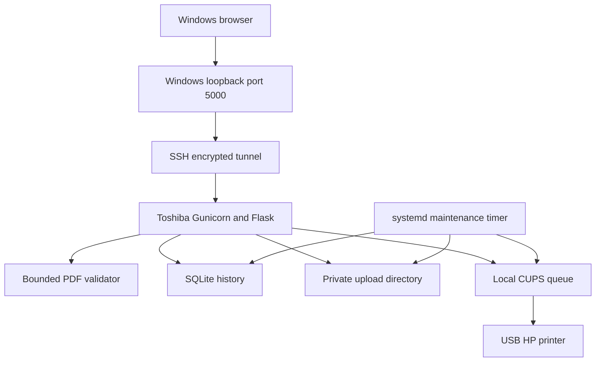

# Architecture and data lifecycle

## Current topology

Network encryption is provided by SSH between hosts. HTTP exists on the two loopback ends. The printer leg is USB. This is not a UDP document-transfer architecture. Direct LAN browser access and HTTPS reverse proxy setup are deferred until the firewall lab.

## Submission

GET / creates a signed, expiring form token bound to a random browser-session identifier. POST verifies the token and its session. A unique SQLite index reserves the token atomically before writing or printing. A repeated valid request redirects to the existing job; it cannot call lp a second time for that token. New forms create new tokens: deliberately opening a new form and uploading again is a new print, not content-level deduplication.

The generated UUID names the on-disk file. The original filename is display metadata only. A separate Python process inspects the PDF with a 512 MiB address-space cap, 10 seconds CPU and a 15-second parent timeout. Valid files are submitted with an argument list to lp, no shell. The CUPS job title is `home-print-<UUID>`, which permits reconciliation if the response or database update is lost. The web request returns a 303 redirect to a GET result page.

## State transitions

validating → submitting → submitted → queued/held/processing/stopped → completed/canceled/failed.

Unreadable input becomes rejected. Ambiguous submissions become needs_review. A worker interruption in validating older than five minutes becomes rejected and is cleaned; a stale submitting job is reconciled by title. Missing or ambiguous CUPS matches are never automatically retried. Legacy saved records do not have reliable submission identity and require manual review.

CUPS job state 9 is completion reported by CUPS, not guaranteed physical output. Original uploads are removed on the next successful maintenance pass, usually about 15 seconds after completion. OS scheduling, a sleeping host, or CUPS/DB outages can delay cleanup. Completion is committed before deletion; deletion is recorded afterward. If the process dies between the two, missing_ok allows the next run to finish bookkeeping.

Canceled/failed jobs retain source files for 24 hours, then cleanup removes them if terminal state is still verifiable. Uncertain jobs are retained for review. There is no unlimited automatic retry. History is retained without an automatic purge in this release; periodic metadata retention/reporting policy is deferred.

## Two storage copies

Application upload files and CUPS spool files are separate. The host was configured with PreserveJobFiles No, validated with cupsd -t and restarted. Verify real CUPS file retention behavior during acceptance; the app never deletes arbitrary files inside the CUPS spool directory. Temporary request files can also be created by the web stack and are closed at request teardown.

Deleting a filesystem entry recovers usable space; it is not certified secure erasure. System snapshots and external backups need their own retention policies.

## Database compatibility

Existing print_jobs records are preserved. Added columns include owner_token, submission_token, cups_title, error_message and terminal_at; earlier submitted_by, cups_job_id, completed_at and file_deleted_at are retained. NULL submission tokens permit legacy rows. New rows have a unique token. SQL values use parameters. Migration and cleanup use explicit transactions and close connections.
